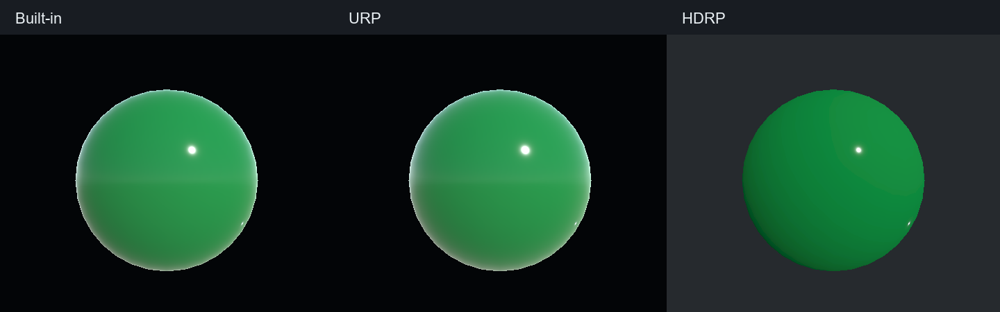

# 0.3.6 逻辑光源玉石：实际验证

用户参考：[方木君《Unity移动端高性能玉石材质》](https://mp.weixin.qq.com/s/fzxGFhe5DofKpyauJSPypg)。公开内容只有一个散射函数，没有完整 Shader、默认值和场景。固定函数 UTF-8/LF SHA-256：`a9cc314b7587c26e32c17e12fd87f0a8dffb19447ad5528a1522e33dac99993f`。原参考与图片只在不分发的 `.build~/JadeReference036` 中保存。

最终结果以 [verification.json](verification.json) 为准。新增一个同源方案、三份实际 ASE 图；每图 50 个实际原生节点、五组中文气泡、0 Custom Expression。完整目录为 111 方案 / 293 图（Built-in 91、URP 91、HDRP 111），91 个三图齐备、66 个三目标功能映射。40 个缺失版本、49 个已有功能缺口和 80 个旧本地 Graph 阻塞没有被本次解除。研究来源新增一个文章身份，合计 1,080；0.3.5 的 290 图、旧契约与旧来源均与固定发布包比对保持原样。

测试环境：Unity 2022.3.10f1、ASE 1.9.9.13、URP/HDRP 14.0.8、Windows D3D11；三隔离项目均为 Linear。每个项目执行实际 `probe`、目标模板与节点 `describe`、`generatePlan`、ASE 保存重载、同步 Shader 编译。新受限方向变换适配器仅接受规范化的 World → Object 三项组合，并核对重载后的值。

| 验证范围 | 实际结果 |
| --- | --- |
| 材质图保存重载、编译 | 三管线各一份通过；另有不分发的公式诊断图各一份。 |
| 核心公式浮点回读 | 三管线各 14 组，合计 42；CPU 参考最大通道误差 `4.875659942626953e-5`，阈值 `1e-4`。 |
| 跨管线公式夹具 | 同色彩空间、同输入的 28 组比较，最大通道差 0；仅比较核心公式。 |
| 实际管线相机 | 三管线通过：散射开关、绿/紫色、主方向光转动产生可见变化。 |
| 目录与材质安装 | 三管线通过 API、窗口打开、搜索、新材质关键词初始化、重复安装复用及用户参数保留。 |
| 核心检查 | 540 项通过。 |
| Editor 引用编译 | 0 警告、0 错误。 |

14 个状态为默认、两种深度距离、两种逻辑光源距离、两种指数、映射下限、映射上限、乘色后逐通道饱和、中心偏移、手动光方向、旋转/非等比缩放、模型与相机共同平移。CPU 参考读取实际对象空间位置与方向，并将 ShaderLab Color 的 Inspector sRGB 值转换为 Linear GPU uniform 值后比较。第一次 CPU 夹具没有转换该颜色导致失败，修正夹具后复测通过，没有改变核心节点公式。

HDRP 的原生 Transform Direction 会额外声明相机矩阵，与 UnityCG 原始诊断宿主的已有声明冲突。诊断模板仅将新增且本运算未使用的声明局部改名，真实矩阵和材质 Lit 模板没有更改。两次失败的诊断图、编译日志、首次颜色夹具失败及 Unity 授权握手重试均保留在 `.build~/JadeReference036/Attempts` 和隔离输出中；未绕过 Unity 授权。

补充材质使用各管线的标准 Lit：核心散射接 Emission，提供表面色、光滑度与散射贡献。文章没有提供这些接法，不能把它们说成作者完整实现。核心保留不依赖灯色、强度、阴影及法线的行为；Emission 的透光不自动接收遮挡。固定公式一致不代表不同管线的标准 Lit BSDF、曝光、原材质或原场景一致。`visualComparisonPassed`、`originalSceneEquivalent` 保持 false；没有移动端或 GPU 性能结论。

复现工具为 `Tools~/Build-JadeArticle.py`、`Tools~/Run-JadeArticle.ps1`、`Tools~/Collect-JadeArticle.py`、`Tools~/Verify-JadeArticle.py`、`Tools~/Verify-JadeRelease.py`，Unity 夹具为 `Tests/UnityJadeArticleValidation.cs`。Build 工具要求本地保留已审查的文章缓存并检查固定函数哈希，不自动信任更新后的代码。Runner 在三个 `.validation` 项目工作；依次执行单管线 Build、Validate、收集后 Batch，每次须等待已启动 Unity 退出，再进行下一步或修改共享 C#。发布用 `Tools~/Build-Release.ps1`，包校验见 `Releases~/release-verification-0.3.6.json`。详细参数和使用见 [JadeArticle.md](../../JadeArticle.md)。
